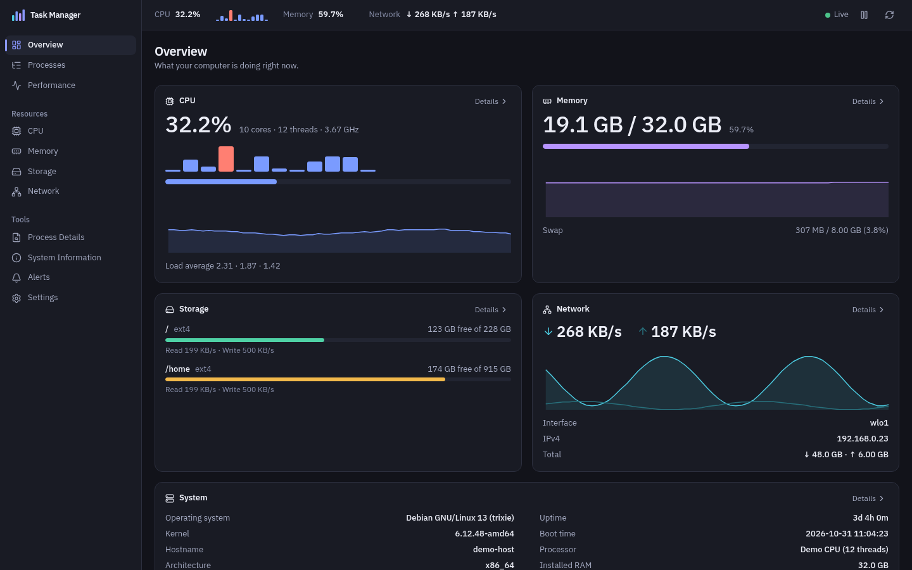
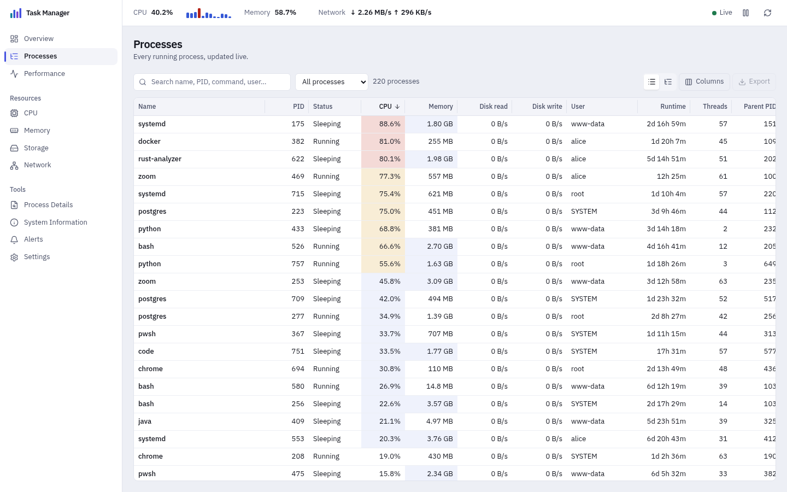

# Task Manager



<sub>Overview in the dark theme. Screenshots use synthetic sample data, not a real machine.</sub>

A fast, private, cross-platform task manager and system monitor for Windows
and Linux. It shows what your computer is doing in real time (processes, CPU,
memory, storage and network) and lets you safely end, suspend or reprioritize
processes.

Built with Tauri 2, Rust and React. All monitoring stays on your machine: no
telemetry, works fully offline. The only network use is the optional internet
benchmark, which runs only when you press its button and confirm the dialog.

## Screenshots



<sub>Processes in the light theme.</sub>

The screenshots are generated from synthetic data so they never reveal a real
process list, hostname or network address. To refresh them, run `npm run dev`
and open `http://localhost:1420/?preview&theme=dark&route=overview` (dev
builds only), then capture the page.

## Features

- **Overview:** CPU, memory, storage, network and system cards with live
  60-second graphs.
- **Processes:** virtualized table that stays fast with thousands of
  processes.
  - Instant search by name, PID, command line, executable or user.
  - Filter presets: high CPU, high memory, my/system processes, suspended,
    recently started, long running, heavy disk I/O.
  - Sortable, resizable, show/hide columns; optional heat mapping; compact
    mode.
  - Tree view with expand/collapse, safe against PID reuse.
  - Keyboard navigation.
- **Process details:** general info, CPU/memory/disk history, working
  directory, architecture, child processes and TCP/UDP connections.
- **Process control:**
  - End, force end, suspend, resume, change priority, copy details, open file
    location.
  - Confirmation dialogs with escalating warnings.
  - Server-side protection for critical system processes and for Task Manager
    itself.
- **Benchmarks:** a repeatable CPU benchmark (single-core and multi-core:
  integer, floating point, SHA-256, compression) and a GPU compute benchmark
  (integer, floating point, memory bandwidth, with every result checked against
  a CPU reference), with scores, run history and safe comparison between
  results, a disk benchmark (sequential and random speed, latency percentiles,
  queue depths; Linux) and an internet test (latency, jitter, download and
  upload against Cloudflare's speed endpoints, only after you confirm).
  Runs on Windows and Linux with the same methods. See [docs/BENCHMARKS.md](docs/BENCHMARKS.md).
- **Performance:** large CPU, memory, disk and network graphs over
  60 s / 5 min / 15 min / 1 h.
- **CPU, Memory, Storage, Network pages:**
  - per-core graphs;
  - cache and commit charge;
  - disk IOPS and active time;
  - per-interface rates and addresses.
- **Alerts:** rules such as _"node CPU above 80% for 20 s"_ or _"memory above
  85%"_, evaluated in the background with desktop notifications.
- **Settings:** theme (system/light/dark), refresh interval
  (500 ms – 5 s or paused), history length, start with the OS, minimize to
  tray, launch minimized, remember window position, debug logging.
- **System tray** with live CPU/RAM summary and pause/resume.
- **Export:** process list as CSV/JSON (command lines opt-in), system summary,
  diagnostics bundle.
- **Keyboard:**

  | Shortcut   | Action                                   |
  | ---------- | ---------------------------------------- |
  | Ctrl/Cmd+F | Search processes                         |
  | Ctrl/Cmd+R | Refresh                                  |
  | Space      | Pause/resume monitoring                  |
  | Delete     | End selected process, after confirmation |
  | Ctrl/Cmd+K | Command palette                          |
  | Esc        | Close dialogs                            |

## Supported operating systems

| OS                                         | Status                                               |
| ------------------------------------------ | ---------------------------------------------------- |
| Windows 11 (x64)                           | Supported (primary)                                  |
| Debian / Ubuntu and other mainstream Linux | Supported                                            |
| macOS                                      | Not yet; the architecture has a platform slot for it |

Platform differences are documented in
[docs/PLATFORM_SUPPORT.md](docs/PLATFORM_SUPPORT.md).

## Technology

| Layer         | Choice                                                  |
| ------------- | ------------------------------------------------------- |
| Desktop shell | Tauri 2                                                 |
| Backend       | Rust (2024 edition), `sysinfo`, `windows` crate, `libc` |
| Frontend      | React 19, TypeScript 6 (strict), Vite 8                 |
| UI            | Tailwind CSS 4, Radix primitives, Lucide icons          |
| State         | Zustand                                                 |
| Charts        | uPlot (canvas)                                          |
| Tables        | TanStack Virtual                                        |
| Tests         | `cargo test`, Vitest, React Testing Library             |

## Development

Prerequisites:

- Node.js 20+ (developed with 24).
- Rust stable (1.90+), via [rustup](https://rustup.rs).
- **Windows:** Microsoft C++ Build Tools ("Desktop development with C++")
  and the WebView2 runtime, which ships with Windows 11.
- **Linux:**

  ```sh
  sudo apt install libwebkit2gtk-4.1-dev build-essential curl wget file \
    libxdo-dev libssl-dev libayatana-appindicator3-dev librsvg2-dev
  ```

Run in development:

```sh
npm install
npm run tauri dev
```

## Building

```sh
npm run tauri build
```

| Platform | Output (`src-tauri/target/release/bundle/`)   |
| -------- | --------------------------------------------- |
| Windows  | `msi/` (WiX) and `nsis/` (per-user installer) |
| Linux    | `deb/`, `rpm/` and `appimage/`                |

Build each platform on that platform; CI builds both. To build only the
executable, without installers: `npx tauri build --no-bundle`.

## Testing and checks

```sh
npm run typecheck        # TypeScript (strict)
npm run lint             # ESLint
npm run format:check     # Prettier
npm test                 # Vitest + React Testing Library
npm run check:linux      # type-check and lint Linux Rust code (needs: rustup target add x86_64-unknown-linux-gnu)
npm run check:all        # everything above plus cargo fmt, clippy -D warnings and cargo test
npm run gen:types        # regenerate TypeScript types from Rust models
```

Rust tests include integration tests against the real OS:

- the engine produces valid snapshots;
- a spawned child process is suspended, resumed and killed;
- this test process's sockets, architecture and disks are read.

They never touch processes they did not start.

## Architecture

```
OS ──► tm-core (Rust, no UI dependency)
         platform/{windows,linux,macos}  ─►  monitoring engine (one thread)
                                              ├─ alerts, history, process control
                                              └─ TickSink ──► Tauri Channel ──► React stores ──► views
```

- `src-tauri/core`: models, monitoring engine, platform layer, process control
  and export. Testable on its own.
- `src-tauri/src`: Tauri wiring, typed commands, tray, settings file,
  logging.
- `src`: React app. `services/` talk to the backend, `stores/` hold state,
  and `features/` contain one folder per page with pure, tested logic.

See [docs/ARCHITECTURE.md](docs/ARCHITECTURE.md) and
[docs/MONITORING.md](docs/MONITORING.md).

## Security model

- Process control runs through native APIs only, with no shell and no
  generic command execution.
- Every PID is validated and re-checked against its start time, so a reused
  PID is never acted on.
- Protection rules run in Rust on every request. The UI cannot bypass them.
- The app is unprivileged. It never elevates itself; denied operations say
  so clearly.
- Tauri capabilities are limited to `core:default`. Plugins are used from Rust
  only.
- Command lines are never logged, and are excluded from exports unless you
  opt in.

Details: [docs/SECURITY.md](docs/SECURITY.md).

## Performance

Measured on a 12-thread laptop with ~240 processes:

- About 1.3% total CPU with the window visible, and 0.1% when minimized.
- The Rust backend uses 18 MB.
- WebView2 adds roughly 200 MB, as it does for any WebView2 app.

Details and methodology: [docs/PERFORMANCE.md](docs/PERFORMANCE.md).

## Contributing

1. Read [docs/ARCHITECTURE.md](docs/ARCHITECTURE.md).
2. Keep OS-specific code in `src-tauri/core/src/platform/<os>`, and add a
   stub for every other OS.
3. Put logic in pure, tested functions; keep components thin.
4. Never report invented values. Use `null` / "Unavailable on this platform".
5. Run `npm run check:all` (and `npm run check:linux` for platform code)
   before opening a pull request.

The roadmap is in [docs/ROADMAP.md](docs/ROADMAP.md).

## Known platform differences

- On Windows without administrator rights, protected processes show memory
  but not CPU, I/O, owner or command line. These are labelled as unavailable,
  never shown as 0.
- Windows reports the nominal CPU frequency; Linux reports the current one.
- Graceful "End process" on Windows asks the process's windows to close.
  Windowless processes need "Force end".
- Load average and buffers exist only on Linux; commit charge only on
  Windows.

## License

MIT
