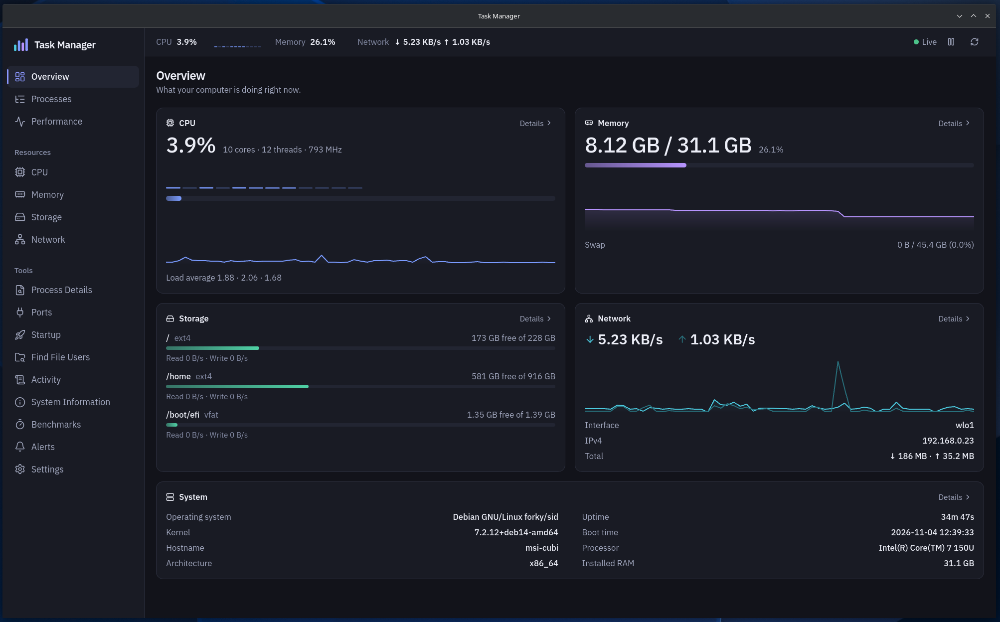
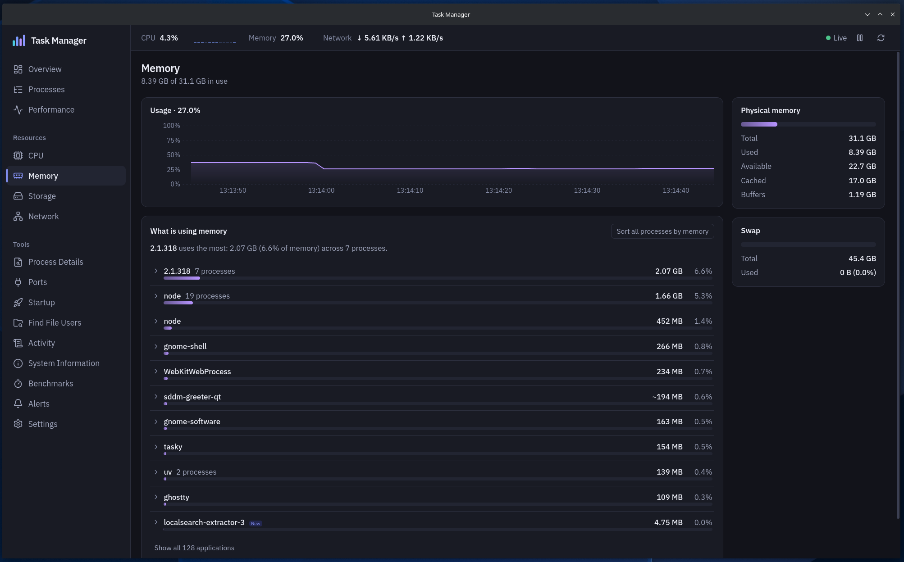
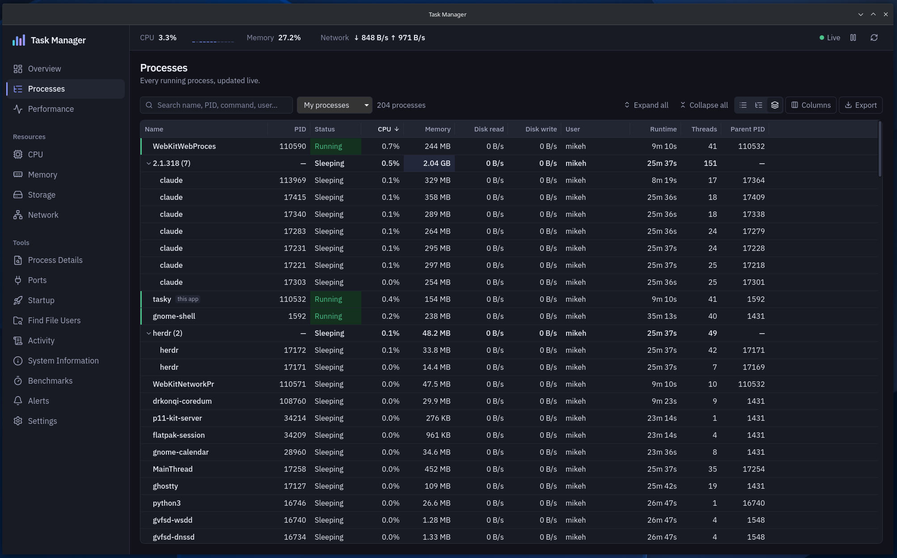

# Tasky


<sub>Overview in the dark theme (synthetic sample data).</sub>

A fast, private, cross-platform task manager and system monitor for Windows
and Linux, with a native Linux port that works on both **KDE Plasma** and
**GNOME**. It shows what your computer is doing in real time (processes, CPU,
memory, storage and network) and lets you safely end, suspend or reprioritize
processes.

Built with Tauri 2, Rust and React. All monitoring stays on your machine: no
telemetry, works fully offline. The only network use is the optional internet
benchmark, which runs only when you press its button and confirm the dialog.

## Screenshots

### Linux (GNOME)

The native Linux port running on GNOME (Wayland), dark theme.







### Themes


<sub>Processes in the light theme (synthetic sample data).</sub>

The `overview-dark` and `processes-light` screenshots are generated from
synthetic data; the three GNOME screenshots are from a real machine. To
refresh the synthetic ones, run `npm run dev` and open
`http://localhost:1420/?preview&theme=dark&route=overview` (dev builds only),
then capture the page.

## Features

- **Overview:** CPU, memory, storage, network and system cards with live
  60-second graphs.
- **Processes:** virtualized table that stays fast with thousands of
  processes.
  - Instant search by name, PID, command line, executable or user.
  - Filter presets: high CPU, high memory, my/system processes, suspended,
    recently started, long running, heavy disk I/O.
  - Sortable, resizable, show/hide columns; optional heat mapping; compact
    mode.
  - Tree view with expand/collapse, safe against PID reuse.
  - Keyboard navigation.
- **Process details:** general info, CPU/memory/disk history, working
  directory, architecture, child processes and TCP/UDP connections.
- **Process control:**
  - End, force end, suspend, resume, change priority, copy details, open file
    location.
  - Confirmation dialogs with escalating warnings.
  - Server-side protection for critical system processes and for Tasky
    itself.
- **Benchmarks:** a repeatable CPU benchmark (single-core and multi-core:
  integer, floating point, SHA-256, compression) and a GPU compute benchmark
  (integer, floating point, memory bandwidth, with every result checked against
  a CPU reference), with scores, run history and safe comparison between
  results, a disk benchmark (sequential and random speed, latency percentiles,
  queue depths; Linux) and an internet test (latency, jitter, download and
  upload against Cloudflare's speed endpoints, only after you confirm).
  Runs on Windows and Linux with the same methods. See [docs/BENCHMARKS.md](docs/BENCHMARKS.md).
- **Performance:** large CPU, memory, disk and network graphs over
  60 s / 5 min / 15 min / 1 h.
- **CPU, Memory, Storage, Network pages:**
  - per-core graphs;
  - cache and commit charge;
  - disk IOPS and active time;
  - per-interface rates and addresses.
- **External drives (Linux):** mount and unmount USB sticks, SD cards and
  external disks from the Storage page, and power a drive off once it is
  unmounted. System and internal partitions are never offered and are refused
  by the backend. Needs UDisks (`udisks2`).
- **Services (Linux, systemd):** see every service, its state and main process,
  and start, stop or restart it. System-critical services (systemd, D-Bus,
  networking, the display manager and similar) are shown but locked. Stop and
  restart ask first, and changes to system services use your desktop's own
  authorization prompt.
- **Alerts:** rules such as _"node CPU above 80% for 20 s"_ or _"memory above
  85%"_, evaluated in the background with desktop notifications.
- **Settings:** theme (system/light/dark), refresh interval
  (500 ms – 5 s or paused), history length, start with the OS, minimize to
  tray, launch minimized, remember window position, debug logging.
- **System tray** with live CPU/RAM summary and pause/resume.
- **Export:** process list as CSV/JSON (command lines opt-in), system summary,
  diagnostics bundle.
- **Keyboard:**

  | Shortcut   | Action                                   |
  | ---------- | ---------------------------------------- |
  | Ctrl/Cmd+F | Search processes                         |
  | Ctrl/Cmd+R | Refresh                                  |
  | Space      | Pause/resume monitoring                  |
  | Delete     | End selected process, after confirmation |
  | Ctrl/Cmd+K | Command palette                          |
  | Esc        | Close dialogs                            |

## Supported operating systems

| OS                                 | Status                                               |
| ---------------------------------- | ---------------------------------------------------- |
| Windows 11 (x64)                   | Supported (primary)                                  |
| Debian 12+ / Ubuntu 22.04+ (amd64) | Supported; works on KDE Plasma and GNOME             |
| Other Linux distributions          | Not tested; build from source                        |
| macOS                              | Not yet; the architecture has a platform slot for it |

**Linux desktops:** the Linux port is available and compatible with both
KDE Plasma and GNOME, on Wayland. Release builds ship a `.deb` only (APT
repository and GitHub Releases); `.rpm` and AppImage can be built locally (see
Building).

| Desktop    | Status           | System tray                               | Window position                                                                |
| ---------- | ---------------- | ----------------------------------------- | ------------------------------------------------------------------------------ |
| KDE Plasma | Tested (Wayland) | Built in (StatusNotifier)                 | No known limitation                                                            |
| GNOME      | Tested (Wayland) | Needs the AppIndicator extension          | Size always remembered; position only via XWayland at 100% scaling (see below) |
| Others     | Not verified     | Needs StatusNotifier/AppIndicator support | Depends on the compositor                                                      |

Without a tray host, closing the window quits the app, and a window that starts
hidden is shown after 15 s. On GNOME, Wayland apps cannot read or set their own
position, so Tasky runs through XWayland at 100% scaling on every monitor to
remember it, and stays on native Wayland with fractional or HiDPI scaling. Set
`GDK_BACKEND=wayland` (or `x11`) to choose yourself. Details:
[docs/PLATFORM_SUPPORT.md](docs/PLATFORM_SUPPORT.md).

## Install from the Debian APT repository

Browse the [Tasky landing page](https://mikeholp87.github.io/Tasky/).

The signed APT repository provides `amd64` packages for Ubuntu 22.04 or newer
and Debian 12 or newer.

Install the tools needed to add the repository:

```sh
sudo apt update
sudo apt install ca-certificates curl gnupg
```

Download the repository signing key and verify its full fingerprint before
trusting it. It must be
`48F80DD56C8966D259B211C81D4B05C4EEA1F6B4`:

```sh
curl -fsSLo /tmp/tasky-archive-keyring.asc \
  https://mikeholp87.github.io/Tasky/tasky-archive-keyring.asc
gpg --show-keys --with-fingerprint /tmp/tasky-archive-keyring.asc
```

If the fingerprint matches, install the key in its own APT keyring and add the
Tasky source:

```sh
gpg --dearmor --output /tmp/tasky-archive-keyring.gpg \
  /tmp/tasky-archive-keyring.asc
sudo install -D -m 0644 /tmp/tasky-archive-keyring.gpg \
  /usr/share/keyrings/tasky-archive-keyring.gpg
echo 'deb [arch=amd64 signed-by=/usr/share/keyrings/tasky-archive-keyring.gpg] https://mikeholp87.github.io/Tasky stable main' \
  | sudo tee /etc/apt/sources.list.d/tasky.list >/dev/null
```

Install and launch Tasky from your desktop application menu:

```sh
sudo apt update
sudo apt install tasky
```

To update Tasky when a new release is published:

```sh
sudo apt update
sudo apt install --only-upgrade tasky
```

To uninstall Tasky and remove the repository configuration:

```sh
sudo apt remove tasky
sudo rm /etc/apt/sources.list.d/tasky.list \
  /usr/share/keyrings/tasky-archive-keyring.gpg
sudo apt update
```

Standalone `.deb` packages and SHA-256 checksums are also available from
[GitHub Releases](https://github.com/mikeholp87/Tasky/releases). See
[docs/DEBIAN_PACKAGING.md](docs/DEBIAN_PACKAGING.md) for release and repository
maintenance details.

Platform differences are documented in
[docs/PLATFORM_SUPPORT.md](docs/PLATFORM_SUPPORT.md).

### Release notes

**0.1.5** (current)

- **Safer process actions:** menus, the Ports page and Process Details links
  act only on the exact process you picked, never on a new one that reused
  its PID. Suspending or ending your desktop session now warns first.
- **Drives:** unmounting and powering off ask first, and power-off refuses
  unless it can confirm nothing on the drive (including LUKS/LVM volumes) is
  still mounted. A dead network mount no longer freezes the metrics; network
  mounts are no longer listed.
- **Services:** desktop-session services are locked; stopping SSH, PipeWire
  and similar shows a warning.
- **Reliability:** a page error no longer blanks the window, settings changes
  can't overwrite each other, and a crashing benchmark reports "Failed"
  instead of closing Tasky.
- **Keyboard and screen readers:** the selected process is announced,
  Shift+F10 opens its menu, columns resize with the arrow keys, and view
  switches support arrow keys.

**0.1.4**

- Fixed the login entry written by "Start with the OS" when Tasky had been
  upgraded or rebuilt while running. It could point at a path ending in
  "(deleted)" and never start. If you enabled it before, delete
  `~/.config/autostart/Tasky.desktop` and turn the setting on again.

**0.1.3**

- **Services (Linux, systemd):** see every service and its state, and start,
  stop or restart it. System-critical services are shown but locked. Stop and
  restart ask first.
- **Power off drives:** after unmounting an external drive, power it off from
  the Storage page before unplugging it.
- **Process Details** now appears in the sidebar only while a process is
  open, and the top bar shows an icon, not only a color, when CPU or memory is
  high.

**0.1.2**

- **External drives:** mount and unmount USB sticks, SD cards and external
  disks from the Storage page. System and internal partitions are never
  offered or touched. Needs `udisks2`, which the package recommends.
- **Storage updates in real time:** plugged-in drives appear on the next tick,
  and unplugged ones disappear within about a second (it used to take up to
  30 s). The disk benchmark's drive list follows along.
- **Design pass:** a calmer Overview, denser process table, a pinned Name
  column when scrolling sideways, and an always-visible CPU core strip.

**0.1.1**

- The app is now named Tasky throughout the interface.
- Process names cut off by Linux's 15-character limit are restored, and
  grouped processes are labelled by name instead of a version number.
- Fixes for process identity (PID reuse), alert durations, settings reset
  races, autostart state and internet benchmark cancellation.
- A `tasky(1)` man page.

## Technology

| Layer         | Choice                                                  |
| ------------- | ------------------------------------------------------- |
| Desktop shell | Tauri 2                                                 |
| Backend       | Rust (2024 edition), `sysinfo`, `windows` crate, `libc` |
| Frontend      | React 19, TypeScript 6 (strict), Vite 8                 |
| UI            | Tailwind CSS 4, Radix primitives, Lucide icons          |
| State         | Zustand                                                 |
| Charts        | uPlot (canvas)                                          |
| Tables        | TanStack Virtual                                        |
| Tests         | `cargo test`, Vitest, React Testing Library             |

## Development

Prerequisites:

- Node.js 20+ (developed with 24).
- Rust via [rustup](https://rustup.rs); `rust-toolchain.toml` pins the
  version CI uses (minimum supported: 1.90).
- **Windows:** Microsoft C++ Build Tools ("Desktop development with C++")
  and the WebView2 runtime, which ships with Windows 11.
- **Linux:**

  ```sh
  sudo apt install libwebkit2gtk-4.1-dev build-essential curl wget file \
    libxdo-dev libssl-dev libayatana-appindicator3-dev librsvg2-dev
  ```

Run in development:

```sh
npm install
npm run tauri dev
```

## Building

```sh
npm run tauri build                                              # Windows
npm run tauri build -- --config src-tauri/tauri.linux.conf.json  # Linux (Tasky name and man page)
```

| Platform | Output (`src-tauri/target/release/bundle/`)   |
| -------- | --------------------------------------------- |
| Windows  | `msi/` (WiX) and `nsis/` (per-user installer) |
| Linux    | `deb/`, `rpm/` and `appimage/`                |

Build each platform on that platform. Only the `.deb` is published; `.rpm`
and AppImage are local builds and are not tested by CI. To build only the
executable, without installers: `npx tauri build --no-bundle`.

## Testing and checks

```sh
npm run typecheck        # TypeScript (strict)
npm run lint             # ESLint
npm run format:check     # Prettier
npm test                 # Vitest + React Testing Library
npm run check:linux      # type-check and lint Linux Rust code (needs: rustup target add x86_64-unknown-linux-gnu)
npm run check:all        # everything above plus cargo fmt, clippy -D warnings and cargo test
npm run gen:types        # regenerate TypeScript types from Rust models
```

Rust tests include integration tests against the real OS:

- the engine produces valid snapshots;
- a spawned child process is suspended, resumed and killed;
- this test process's sockets, architecture and disks are read.

They never touch processes they did not start.

## Architecture

```
OS ──► tm-core (Rust, no UI dependency)
         platform/{windows,linux,macos}  ─►  monitoring engine (one thread)
                                              ├─ alerts, history, process control
                                              └─ TickSink ──► Tauri Channel ──► React stores ──► views
```

- `src-tauri/core`: models, monitoring engine, platform layer, process control
  and export. Testable on its own.
- `src-tauri/src`: Tauri wiring, typed commands, tray, settings file,
  logging.
- `src`: React app. `services/` talk to the backend, `stores/` hold state,
  and `features/` contain one folder per page with pure, tested logic.

See [docs/ARCHITECTURE.md](docs/ARCHITECTURE.md) and
[docs/MONITORING.md](docs/MONITORING.md).

## Security model

- Process control runs through native APIs only, with no shell and no
  generic command execution.
- Every PID is validated and re-checked against its start time, so a reused
  PID is never acted on.
- Protection rules run in Rust on every request. The UI cannot bypass them.
- The app is unprivileged. It never elevates itself; denied operations say
  so clearly.
- The Tauri capability for the local main window allows only event
  listening and the app's own commands. Plugins are used from Rust only.
- Command lines are never logged, and are excluded from exports unless you
  opt in.

Details: [docs/SECURITY.md](docs/SECURITY.md).

## Performance

Measured on a 12-thread laptop with ~240 processes:

- About 1.3% total CPU with the window visible, and 0.1% when minimized.
- The Rust backend uses 18 MB.
- WebView2 adds roughly 200 MB, as it does for any WebView2 app.

Details and methodology: [docs/PERFORMANCE.md](docs/PERFORMANCE.md).

## Contributing

1. Read [docs/ARCHITECTURE.md](docs/ARCHITECTURE.md).
2. Keep OS-specific code in `src-tauri/core/src/platform/<os>`, and add a
   stub for every other OS.
3. Put logic in pure, tested functions; keep components thin.
4. Never report invented values. Use `null` / "Unavailable on this platform".
5. Run `npm run check:all` (and `npm run check:linux` for platform code)
   before opening a pull request.

The roadmap is in [docs/ROADMAP.md](docs/ROADMAP.md).

## Known platform differences

- On Windows without administrator rights, protected processes show memory
  but not CPU, I/O, owner or command line. These are labelled as unavailable,
  never shown as 0.
- Windows reports the nominal CPU frequency; Linux reports the current one.
- Graceful "End process" on Windows asks the process's windows to close.
  Windowless processes need "Force end".
- Load average and buffers exist only on Linux; commit charge only on
  Windows.

## License

MIT
