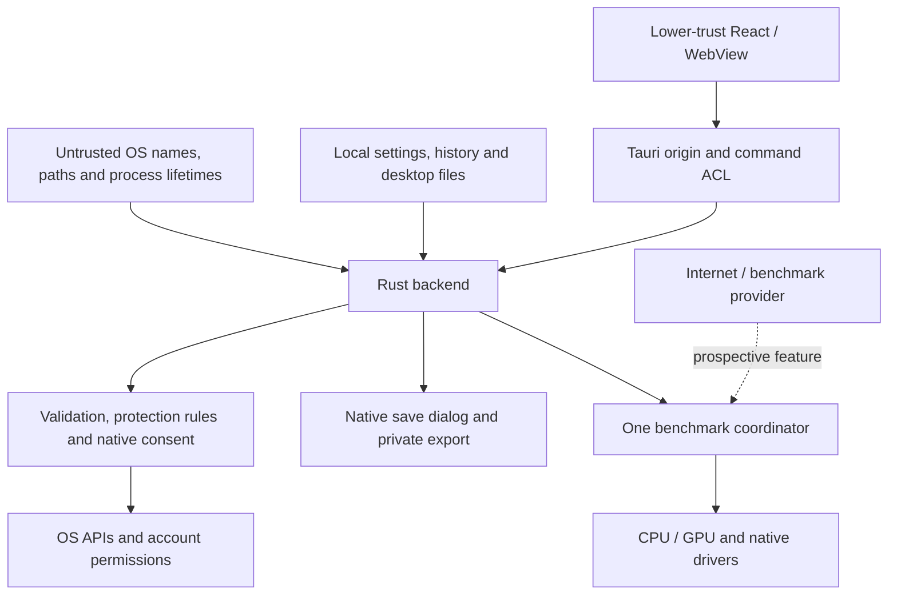

# Threat model

Audit date: 2026-11-03. Baseline: SECURITY_BASELINE.md. This is a normal-user
desktop application, not a privileged broker. A WebView compromise grants
access to permitted commands, not unrestricted OS authority.

## Assets and collection

| Asset                                                   | Exposure and policy                                                               |
| ------------------------------------------------------- | --------------------------------------------------------------------------------- |
| OS and user processes                                   | Native enumeration and typed process controls; respect kernel authorization       |
| User files                                              | Read-only ownership/metadata inspection; exports require native save selection    |
| Command lines, paths, usernames, destinations           | Sensitive, local; command lines excluded from exports by default                  |
| Credentials, process environments, browser/session data | No environment or browser-profile collection, memory-reading IPC, or dump feature |
| Hardware and monitoring history                         | Local, bounded memory; details can identify a machine                             |
| Settings and alert rules                                | Local private JSON; rule names/filters can identify private applications          |
| Benchmark data                                          | Local private history; user-editable, not cryptographically authenticated         |
| Startup configuration                                   | Linux user overrides of known XDG desktop entries; never edit system entries      |
| Services and update packages                            | No service-control broker or updater at baseline; do not assume these exist       |

## Boundaries

The Internet/provider boundary is not implemented in the baseline. Adding a
network benchmark changes the threat model: TLS, fixed backend provider IDs,
redirect control, transfer budgets, timeouts, cancellation, explicit consent,
and bandwidth/privacy disclosure are release requirements. New work appearing
during the audit must be revalidated before release.

## Actors and scenarios

| Actor                              | Attack                                                         | Control / residual risk                                                                                                                                 |
| ---------------------------------- | -------------------------------------------------------------- | ------------------------------------------------------------------------------------------------------------------------------------------------------- |
| Malicious website                  | Navigate privileged window or load executable content          | Bundled scripts, restrictive CSP, navigation allowlist, no remote capability                                                                            |
| Compromised WebView/npm dependency | Invoke destructive commands, queue scans or benchmarks         | Main-only application ACL, Rust validation, native confirmation, bounded jobs and backend benchmark lock; read-only data remains visible to the main UI |
| Compromised crate/build action     | Execute code during build or runtime                           | Lockfiles, registry policy, immutable action SHAs, advisory checks; dependencies are still trusted code                                                 |
| Malicious local process            | XSS through name; PID reuse; misleading Unicode                | React text rendering, live lifetime check, pidfds/handles; coarse start times and display spoofing remain limitations                                   |
| Malformed local file               | Huge JSON, special file, corrupt history                       | Regular-file reads, no-follow semantics, byte/record limits, serde errors and defaults                                                                  |
| Symlink/race attacker              | Truncate a different file through a predictable temporary path | Exclusive random temporary file, private permissions, atomic replacement; trusted parent directories remain a prerequisite                              |
| Accidental user                    | Kill wrong process, lose work, enable startup code, heavy load | Backend protection, native confirmations, stronger force-kill wording, cancellation and bounded profiles                                                |
| Compromised provider               | Redirect/SSRF, unbounded body or uploads                       | No network provider at baseline; prospective release requirements above                                                                                 |
| Malicious update                   | Replace application binary                                     | No auto-updater; distributed installers require independent release integrity checks                                                                    |

## Security invariants

- A frontend boolean cannot authorize dangerous operations: native confirmation
  is required for disruptive process actions, warned actions, benchmarks,
  startup toggles and benchmark-history deletion.
- Never request root, Administrator, debug privileges or a generic shell helper
  to bypass a denied operation.
- No process-memory read/write, arbitrary file-write, arbitrary HTTP, arbitrary
  D-Bus, or arbitrary command-execution IPC.
- A process action uses the cached selection identity **and** a fresh OS
  lifetime check. Linux signals use a pidfd; Windows kill/priority use the
  verified handle. Numeric-PID priority and HWND operations have residual races.
- Diagnostic consent covers indirect identifiers in logs, rules and alerts,
  not merely the explicit process list. Environments are never collected.
- Data already exposed to a compromised native dependency or to the owning OS
  account is outside the protection of WebView ACLs. No claim of protection
  against root, Administrator, kernel or GPU-driver compromise is made.

See SECURITY_AUDIT.md for severity, evidence and unresolved release checks.
